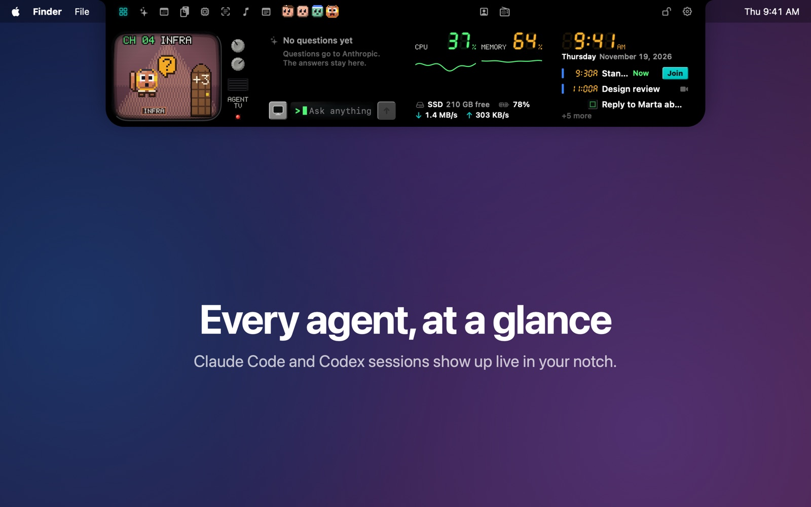
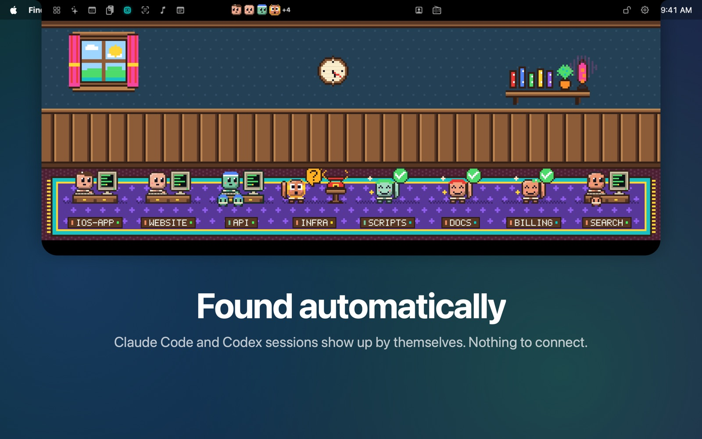
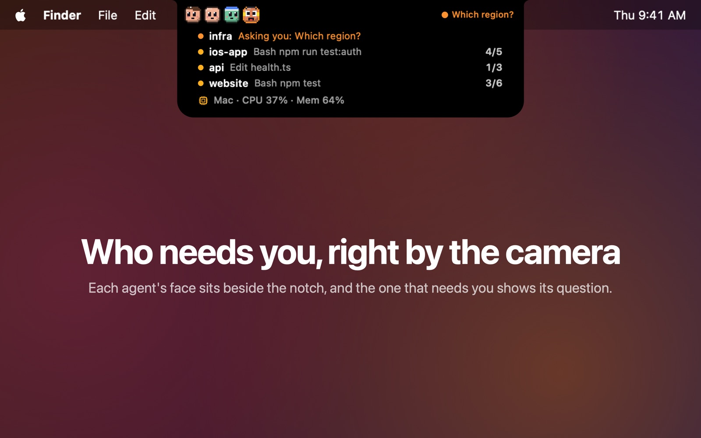

# Scout

**Your AI agents, live in the Mac's notch.**

Scout is a free Mac app that goes looking for the Claude Code and Codex sessions running on your Mac and brings them together in the notch, each one a small pixel character with a face of its own. You see who is working, who needs you and who is done, right by the camera, without switching windows.



Scout is free and open source. No price, no account, no ads, nothing to sign up for.

## Get Scout

- **Download for Mac (free):** https://apps.v-sag.com/scout.html
- **Mac App Store:** in Apple's review.

Scout needs macOS 14 or later. It works on Macs without a notch too, and it can sit on an external display.

## What it does

- **Finds your agents by itself.** Claude Code and Codex sessions show up on their own. Scout reads the session files the agents write on your Mac, read only.
- **The closed notch.** In the 8-bit look, up to four faces beside the camera, one for each agent (the minimal look shows a small count instead). When something happens the notch grows a little: the question of an agent that waits for you, or how far the busiest one has got.
- **The open notch.** One screen of widgets: your agents on a little TV, a quick Ask AI line, the Mac's load, your day with a Join button for calls, and what is playing. There is more: clipboard history, a file tray with AirDrop and converting, radio, a mirror, a teleprompter, notes and timers.
- **The Agents room.** Every agent in one little room: typing at its computer, hand up when it needs you, a green tick when it is done.
- **Ask AI.** Ask Claude or GPT with your own key. Switch Screen on and a picture of your screen goes with the question.
- **Two looks.** 8-bit or minimal, light or dark. English and 33 more languages.





## Privacy

Scout sends nothing to its developer: no account, no analytics, no tracking, no update checks. It reads the agents' session files on your Mac, and nothing from them leaves your Mac.

A few features contact an outside service, and only when you use them:

- Ask AI talks straight to the provider you pick (Anthropic or OpenAI), with your own key. Pictures you attach to a question go to the provider too.
- The weather widget asks Open-Meteo for the forecast of your place or the city you chose. A city name you type to find it goes to Open-Meteo's search. Apple's place lookup names your location.
- The radio asks the Radio Browser directory and plays the station's own stream. A place you type is turned into coordinates by Apple's place lookup first.
- The unit converter tool gets currency rates from Frankfurter, and the links tool reads the title of a link you saved from that link's own site (the app has no button for either tool today).
- The music widget can fetch the cover of what Spotify is playing.
- The development edition (see below) asks LRCLIB for the lyrics of the song that is playing. When you download a video there, yt-dlp contacts that video's site and Scout fetches the video's thumbnail. Its Settings can run `brew install` for yt-dlp and deno, only when you press the button.

The app's About page credits Open-Meteo and Frankfurter. macOS asks for a permission only when you use a feature that needs it (for example the calendar, your location for the weather, the camera for the mirror, the microphone for the teleprompter's voice mode, screen recording for Ask AI's Screen switch).

## Build it yourself

You need an Apple silicon Mac with Xcode 26 or later. Scout is a Swift package: there is no Xcode project to open.

```sh
git clone https://github.com/vsagonas/scout.git
cd scout
scripts/build-app.sh release appstore   # build/appstore/Scout.app
open build/appstore/Scout.app
```

That is the sandboxed edition, from the same source as the download. One difference: the download is archived with Xcode (that project file is not in this repository) and uses `Support/Info-AppStore.plist`, while this script puts `Support/Info.plist` into both editions, so a few permission texts read differently.

- `scripts/build-app.sh` without arguments makes the development edition in `build/Scout.app` (see the table).
- The script signs the app with your "Apple Development" identity when you have one, so macOS remembers the permissions you gave between builds. Without one it signs ad hoc and macOS asks again after each build. Set `SCOUT_SIGN_IDENTITY` to use another identity.
- The script builds for Apple silicon. The app in the download is universal.

### The two editions

| Edition | Made with | What it is |
|---|---|---|
| App Store | `scripts/build-app.sh release appstore` | The edition of the released app. Sandboxed, built with `-D APPSTORE`. It only reads the agents' session files. |
| Development (`full` in the script) | `scripts/build-app.sh` | Not sandboxed, and not what the download gives you. It has extras that are not in the released app (the list below). The self-tests run in this edition. |

The development edition's extras:

- Terminal tabs for agents, through [SwiftTerm](https://github.com/migueldeicaza/SwiftTerm).
- Brightness and media keys (a private macOS framework and a key tap that needs Accessibility).
- A Messages reader that can also send a reply you typed. It needs Full Disk Access, and Contacts for names and photos.
- Synced lyrics, and a heart button that marks the playing Music track as a favourite.
- Battery levels of Bluetooth devices.
- Sending a note straight to Apple Notes (the released app uses the share sheet).
- Listing and running your Shortcuts through the system's `shortcuts` tool (the released app opens a shortcut by its name).
- Video download through yt-dlp (with deno for YouTube), and WebP and MP3 conversion through cwebp and ffmpeg. You install these tools yourself, or let Settings install yt-dlp and deno with Homebrew.
- An Anthropic key in a file you put in Scout's support folder (`import/anthropic.key`) is moved into the Keychain.

### Checks and pictures

Scout tests itself without showing anything on the screen. The checks run in the development edition:

```sh
scripts/build-app.sh
SCOUT_SELFTEST=1 build/Scout.app/Contents/MacOS/Scout --automation --headless --gallery /tmp/scout-gallery --only zzz
```

Each check prints `selftest ok` or `selftest FAIL`, then comes `selftest done: N/N passed`. `--only zzz` names a picture prefix that matches nothing, so only the checks run and no pictures are drawn.

`scripts/gallery.sh [prefix] [folder]` renders the app's views with sample data as PNG files (light and dark) into the folder (`build/gallery` when you name none). It deletes that folder first, and refuses one that holds anything but earlier pictures. It needs a build from `scripts/build-app.sh`. Scripted runs use sample data, their own settings and no network.

### Where things are

| Folder | What is in it |
|---|---|
| `Sources/Scout/App` | The app's start, Settings, the welcome tour |
| `Sources/Scout/Notch` | The notch island, the dashboard and its widgets grid |
| `Sources/Scout/Features` | Agents, Calendar, Radio, Mirror, Tray, Weather, Prompter and the other features |
| `Sources/Scout/Productivity` | Clipboard history, notes, to-dos, timers |
| `Sources/Scout/Ring/AskAI` | Ask AI |
| `Sources/Scout/Ring/Tools` | Small tools that have no button today: calculator, units, links, reminders, voice memo, screen capture |
| `Sources/Scout/Media` | What is playing, the music view, lyrics |
| `Sources/Scout/System` | Volume, battery, Bluetooth |
| `Sources/Scout/Core` | Shared pieces: the look, live activities, self-tests |
| `Sources/Scout/Store` | The scenes of the App Store screenshots |
| `Support` | Info.plist, entitlements, the icon, the translations (`Resources/*.lproj`) |
| `l10n`, `scripts/l10n` | The translation tools |
| `scripts` | Build, gallery, icon and screenshot scripts |
| `docs/media` | The pictures in this README |

## Who made it

I'm Vasileios Sagonas. I have been writing software for 25 years, I work full time, and I build things like Scout on the side because making software is what I love. More of my work is at https://www.v-sag.com.

Bug reports and ideas are welcome in the [issues](https://github.com/vsagonas/scout/issues).

## License

[MIT](LICENSE). Scout's code, pictures and pixel characters are under the same license. The app plays the macOS system sounds, which belong to Apple and are not part of this repository. The development edition uses SwiftTerm, which is MIT too.
